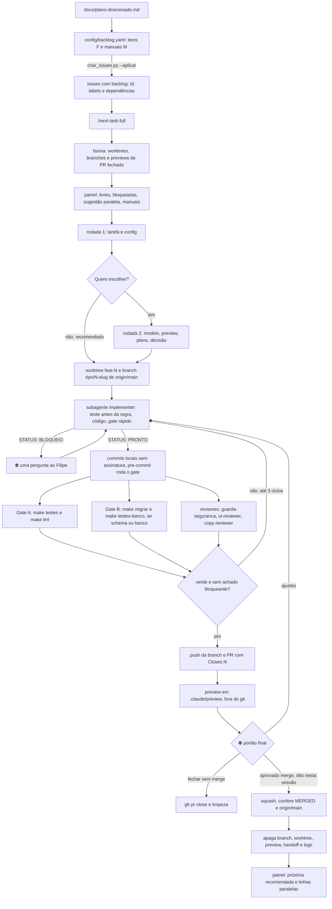
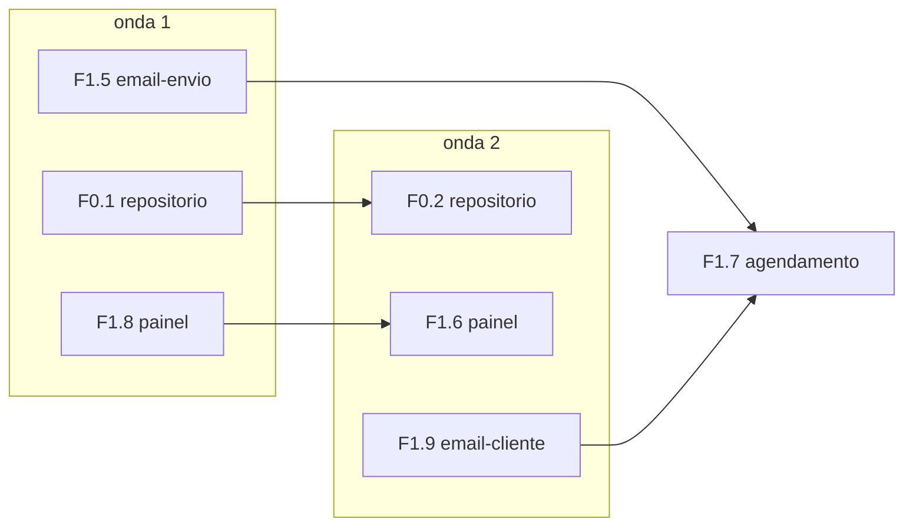

# Fluxo de desenvolvimento

Como uma ideia vira código na `main`: backlog → issue → worktree → implementer → revisão → PR →
preview → "aprovado merge" → squash e limpeza. Decisão em ADR 0022; segurança do fluxo em
`docs/seguranca.md` (seção agentes de IA).

## Visão geral

## Comandos

| Quero… | Comando |
| --- | --- |
| rodar o próximo item, com perguntas | `/next-task-full` |
| rodar um item sem perguntas até o merge | `/next-task-full F1.5 --rec` |
| ver as ondas de paralelismo | `/next-issue` ou `.venv/bin/python scripts/next-task-full/painel.py --ondas` |
| abrir frentes em paralelo | as linhas `claude --permission-mode bypassPermissions -n "<id>" "/next-task-full <id> --rec"` que o painel sugere, uma por terminal |
| transformar ideia em item | `/groom-issue` |
| criar as issues que faltam | `.venv/bin/python scripts/next-task-full/criar_issues.py --aplicar` |
| atualizar a issue depois de mudar a ficha | `criar_issues.py --reescrever <id> --aplicar` |
| mudança pequena fora do backlog, sem subagente | `/feature` |
| gerar um prompt para outra sessão | `/prompt-for-next-task <id>` |
| salvar estado antes de compactar | `/handoff` |
| conferir segurança antes de ligar algo real | `/sec-predeploy` |

## Paralelismo

Regras, aplicadas por `scripts/next-task-full/backlog.py` e testadas em
`tests/test_backlog_painel.py`:

- duas frentes da mesma `zona` nunca rodam juntas
- no máximo uma migration aberta, porque o banco é um só e compartilhado
- item que depende de outro em andamento espera a onda seguinte
- até 3 frentes por padrão (`--frentes N` muda)
- item com `decisao:` não roda em `--rec`: a decisão é perguntada numa sessão com rodada
- manual `M*` nunca roda; aparece em MANUAIS DO FILIPE quando liberado

A ordem real sai sempre do painel; o desenho acima é um exemplo do estado de novembro de 2026.

## Branch, commit e PR

- branch `<feat|fix|chore|docs>/<N>-<slug>`, nunca com `main` ou `master` no nome, sempre de
  `origin/main` atualizada
- commit no imperativo, primeira linha curta, corpo com o porquê e o que foi verificado, sem
  `Co-Authored-By`, `Generated with` ou emoji de assinatura
- autor `lipe0312` com o email noreply do GitHub, nunca o email pessoal
- PR com O Filipe passa a ver · Como conferir · Riscos · Gate · `Closes #N`
- merge só com squash, só com "aprovado merge" do Filipe na própria sessão
- a `main` é protegida no GitHub (item F0.4): sem push direto, sem force push, histórico linear

## Itens manuais

O que exige credencial, consentimento interativo, `sudo`, gasto real ou aprovação humana vira
item `M*` no backlog e issue `manual` com "Como fazer" e "Pronto quando". O Filipe fecha a issue
quando terminar e o painel libera o que dependia dele. O código nunca espera o manual para ficar
pronto: os critérios são provados offline (`docs/fluxos.md`, U5).

## Skills e agentes

| Peça | Papel |
| --- | --- |
| `next-task-full` | orquestrador padrão, de ponta a ponta |
| `next-task`, `feature`, `prompt-for-next-task` | variações para uso à parte |
| `next-issue` | só o mapa de ondas |
| `groom-issue` | ideia → item do backlog → issue |
| `plan-issue` | plano curto antes de codar |
| `preview-aprovacao` | HTML de aprovação, simplificado ou completo |
| `ship` | portão humano, commit, PR, limpeza |
| `handoff` | estado em 15 linhas antes de compactar |
| `sec-predeploy` + `security-audit` | portão de segurança em três níveis |
| `ui-build`, `ui-verify`, `ui-design-references`, `web-design-guidelines` | telas do painel |
| `mkt-copy`, `mkt-cta`, `copywriting`, `copy-editing`, `cro`, `product-marketing` | texto que alguém lê |
| `mkt-carousel`, `mkt-canva` | material de portfólio, publicado à mão |
| `legal-br`, `founder-juridico-br` e irmãs | revisão jurídica, só quando pedida pelo nome |
| agente `implementer` | escreve o código de um item no worktree |
| agente `explorer` | localiza código e plano, só leitura |
| agentes `guarda-seguranca`, `ui-reviewer`, `copy-reviewer` | revisão do diff, da tela e do texto |

Skills de terceiros mantêm o nome e o texto de origem; a procedência está em `skills-lock.json`
e nos `ORIGEM.md`.

## Quando algo dá errado

| Sintoma | O que fazer |
| --- | --- |
| git ou gh pedem permissão | abrir a sessão com `claude --permission-mode bypassPermissions` |
| falta `.env` ou `.venv` no worktree | o Filipe roda `make setup` e cria o `.env` no checkout principal |
| `testes-banco` com conexão recusada | Gate B "pulado (banco parado)"; manual: `make banco` |
| migration editada depois de aplicada | arquivo novo em `db/migrations/`, nunca editar o aplicado |
| PR fechado depois de aplicar migration | o banco tem uma migration que a `main` não tem; o Filipe decide reverter |
| painel acha item pronto que não está | conferir a linha `backlog: <id>` da issue fechada |
