# Fluxos de uso e de requisição

Como o pleito funciona do ponto de vista do Filipe (fluxos de uso) e o que cada pedaço chama, em
ordem, com os controles no caminho (fluxos de requisição). Cada fluxo diz se já existe em `src/`
ou qual item do `config/backlog.yaml` o entrega. Controles detalhados em `docs/seguranca.md`;
fluxo de desenvolvimento em `docs/fluxo-de-desenvolvimento.md`.

Legenda: ✅ implementado · ⏳ item pendente (issue) · 👤 manual do Filipe.

## Fluxos de uso

### U1. Dia típico

✅ coleta (F4.1) · ⏳ funil F4.2 (#24), gerador F3.1 (#22), resumo F1.5 (#15), agendamento
F1.7 (#18), painel F1.6 (#17) e F5.2 (#27), aplicador F6.2 (#30) · 👤 launchd M3 (#40), push M2
(#39), submit real M4 (#41).

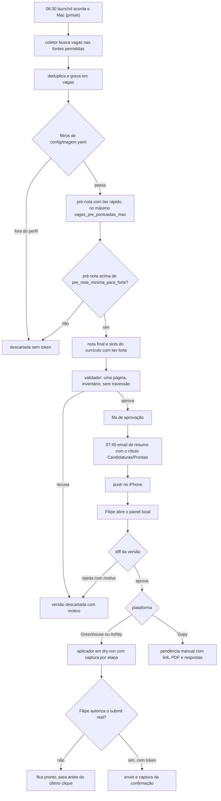

Dia sem vaga boa: o resumo sai mesmo assim, dizendo isso, e nenhuma chamada forte é feita.

### U2. Resposta de empresa chega por email

✅ organizador F1.4, classificador F1.2, gravação de evento F1.3 · ⏳ organizador ligado ao
evento F1.9 (#50), tela Candidaturas F1.6 (#17), Calendar F8.1 (#33) · 👤 autorizar Gmail M1 (#38).
Hoje a rodada rotula e arquiva, e o `gravar_evento` existe, mas um não chama o outro: isso é o F1.9.

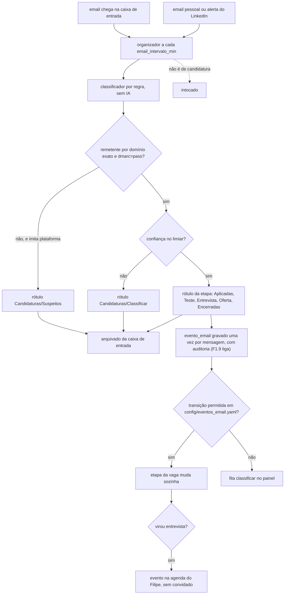

Nada é apagado, encaminhado ou respondido. Link de email nunca é aberto sozinho.

### U3. Vaga da Gupy (sempre manual, ADR 0011)

⏳ F6.3 (#31) · ✅ gatilho de candidatura manual no classificador (F1.2).

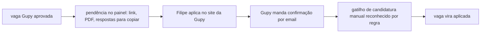

### U4. Ajuste do currículo pelo chat

⏳ F5.1 (#26), F5.3 (#28).

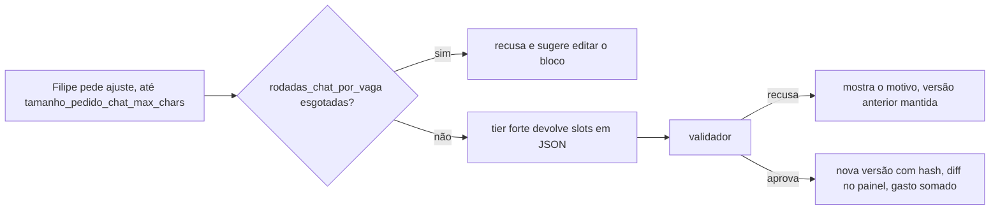

O pedido do Filipe não vence as regras do guia: tecnologia fora do inventário é recusada.

### U5. Evoluir sem todas as credenciais

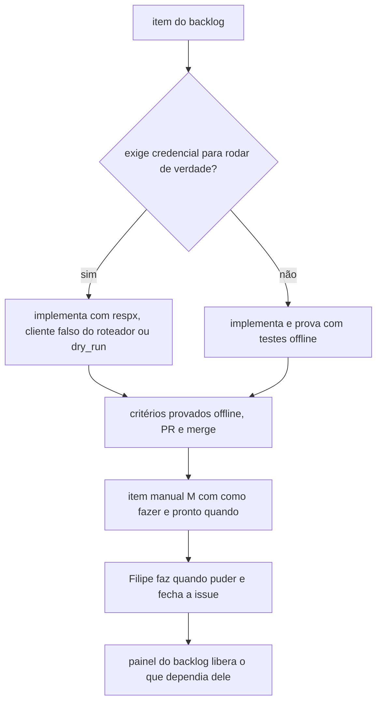

| Credencial ausente | O que continua | O que espera |
| --- | --- | --- |
| refresh token do Gmail (M1) | organizador, eventos, resumo, alertas do LinkedIn nos testes | rodar `make gmail-organizar` de verdade |
| chave da OpenAI ou tier desligado | coleta, filtros, validador, gerador com blocos base, painel | pré-nota, nota final, chat |
| banco parado | `make testes` e lint | `make testes-banco` (Gate B pulado) e o painel com dado |
| token do submit real (M4) | aplicador inteiro em `dry_run` | a prova da página de confirmação |
| escopo do Calendar (M12) | F8.1 nos testes | evento real na agenda |

## Fluxos de requisição

### R1. Autorizar o Gmail (`make gmail-autorizar`) ✅ F1.1, 👤 M1

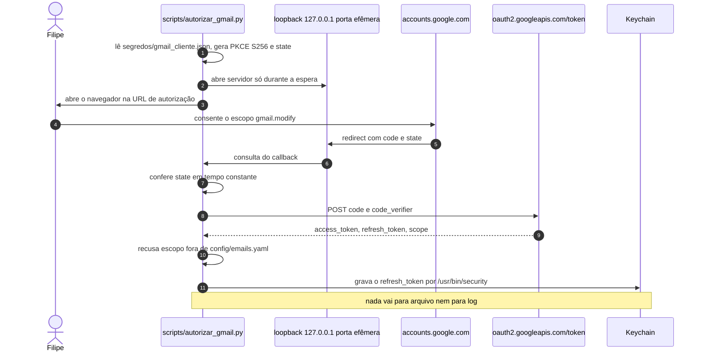

### R2. Rodada do organizador (`make gmail-organizar`) ✅ F1.4

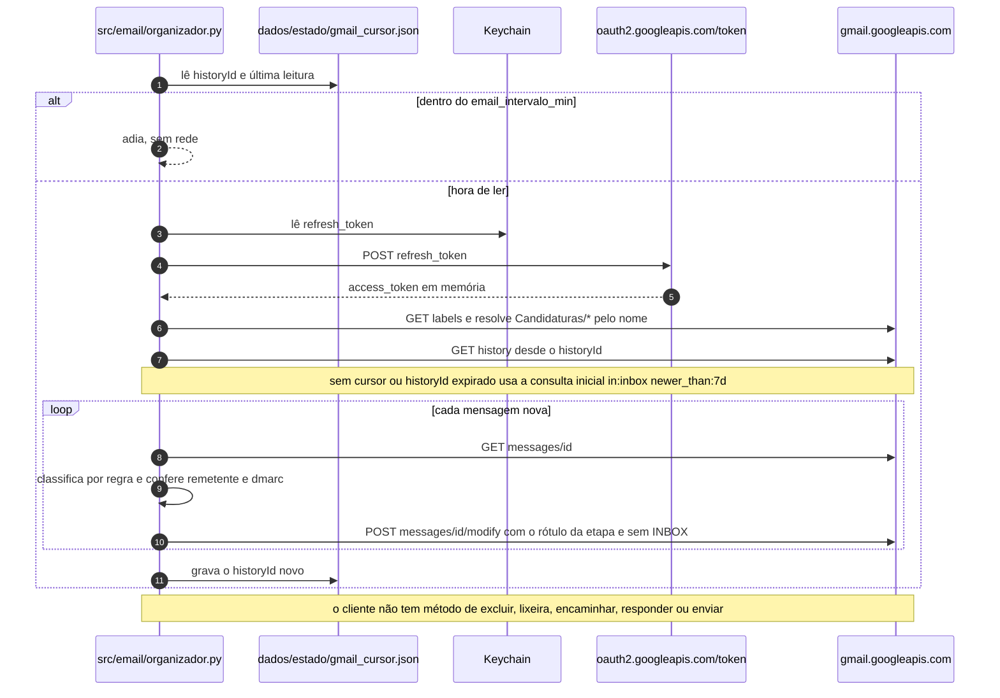

### R3. Gravar evento de email ✅ F1.3

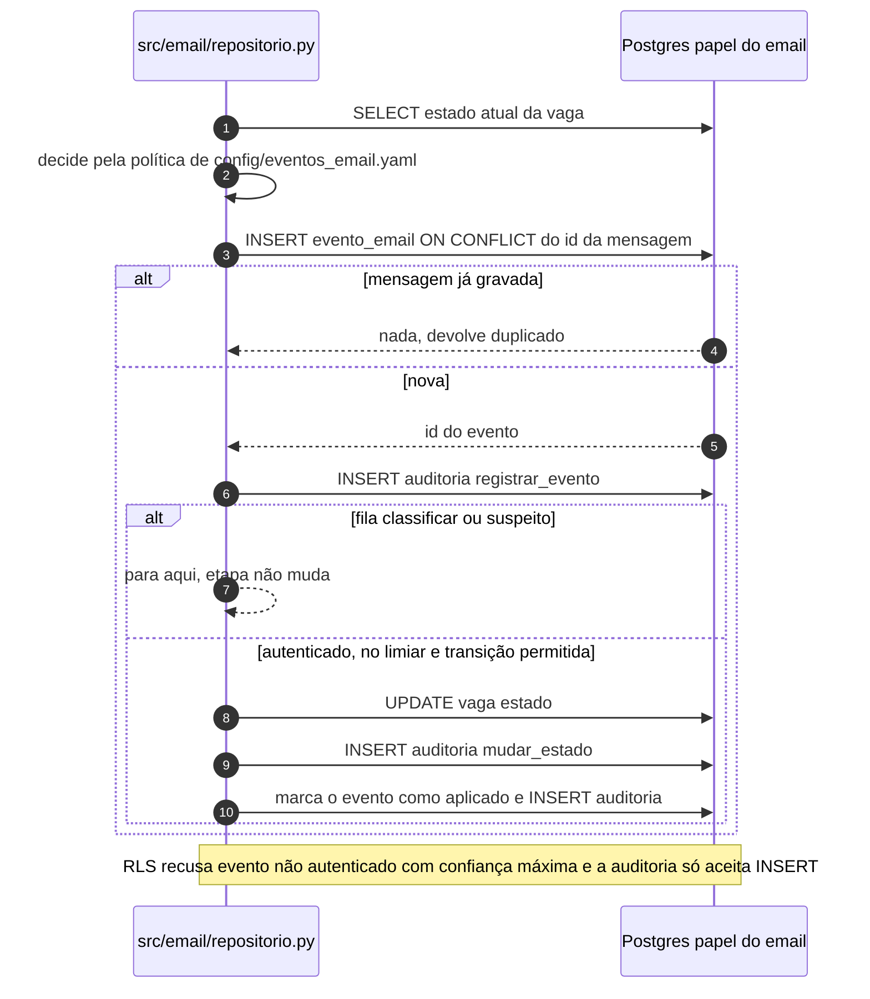

### R4. Coleta de vagas ✅ F4.1

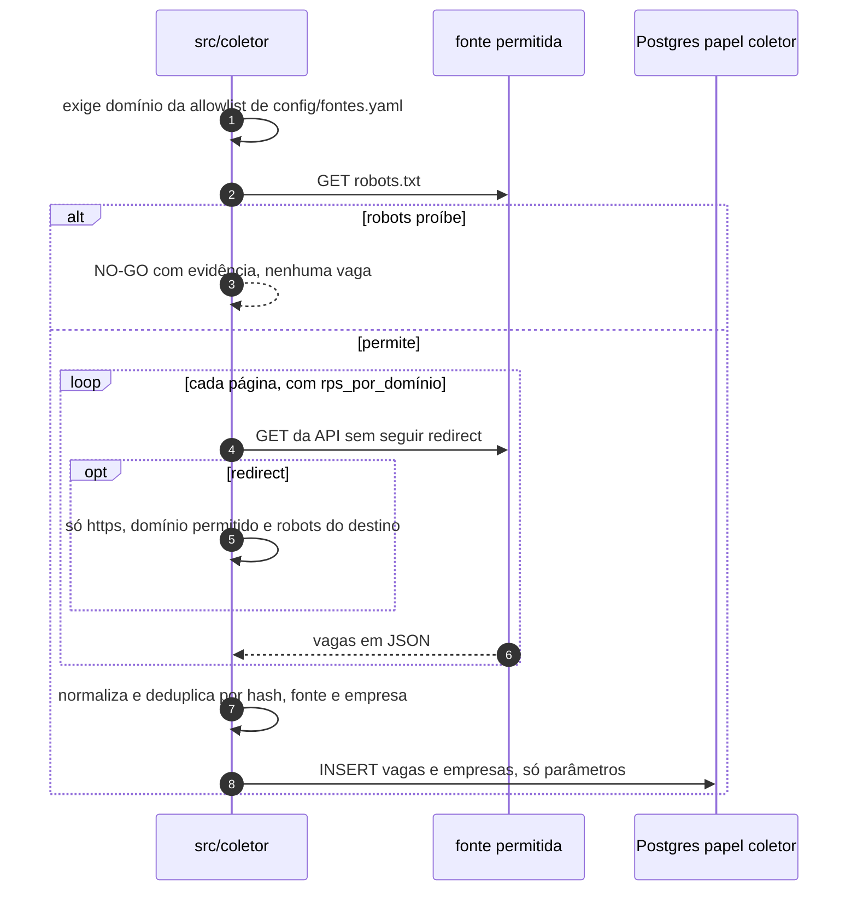

### R5. Chamada ao roteador de LLM ✅ roteador, ⏳ uso em F4.2 (#24) e F3.1 (#22), 👤 M7 e M8

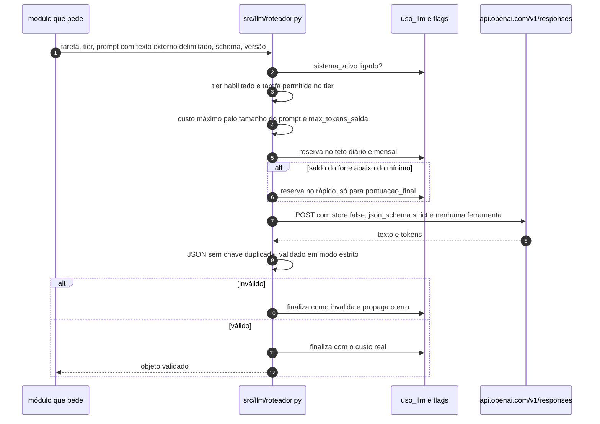

Teto diário ou mensal esgotado bloqueia a chamada sem fallback (ADR 0018). Cache de prompt
desligado (ADR 0019).

### R6. Requisição ao painel ⏳ F1.8 (#16) e F1.6 (#17)

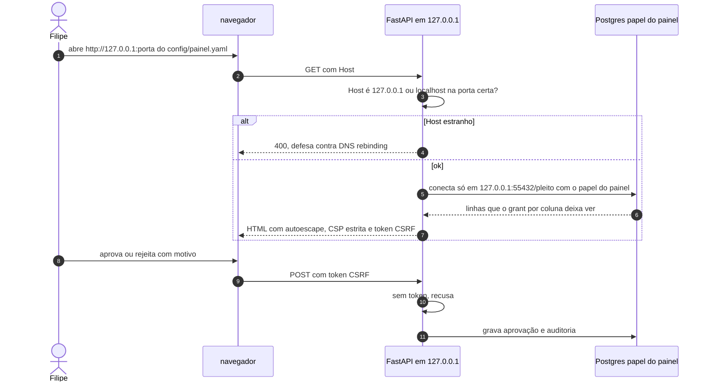

### R7. Resumo diário ⏳ F1.5 (#15), F1.7 (#18)

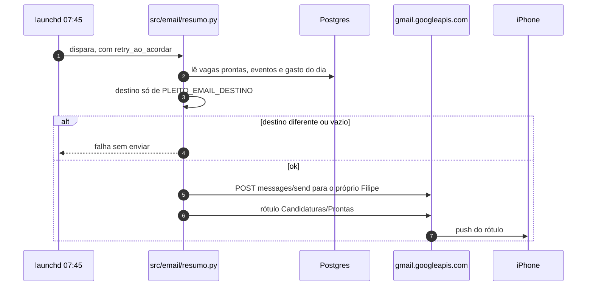

É o único módulo com envio, conferido por teste de arquitetura.

### R8. Aplicador em dry-run ✅ spike, ⏳ F6.2 (#30), 👤 M4

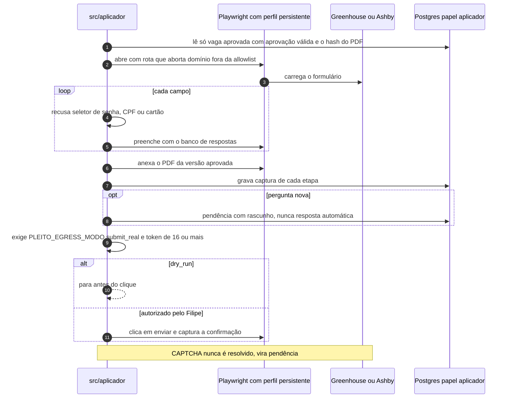

### R9. Gerar currículo por vaga ⏳ F2.2 (#19), F2.3 (#20), F3.1 (#22), F5.1 (#26)

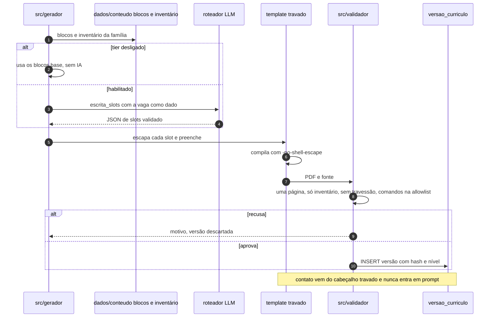

### R10. Sincronizar projetos do GitHub e do portfólio ✅ F2.7, ⏳ tela no F3.4

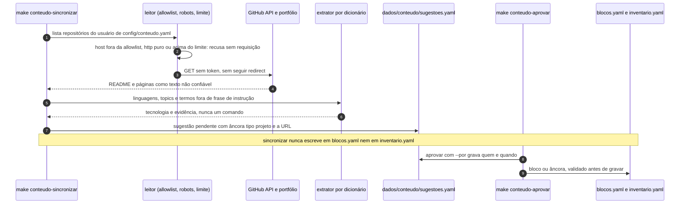
