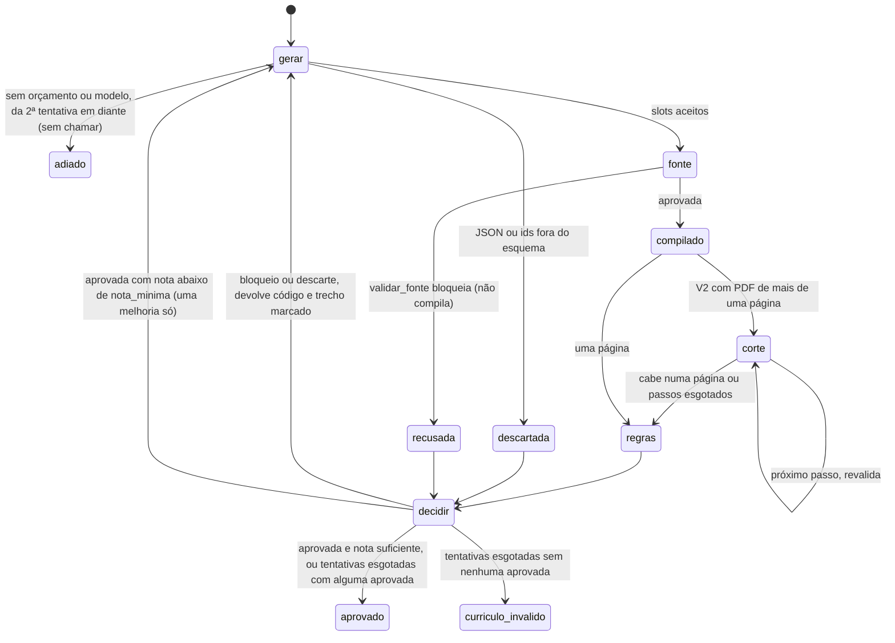

# Geração do currículo: slots, com e sem IA

Como `src/gerador/` transforma blocos, inventário e uma vaga em um `.tex` que o validador aceita. A IA nunca escreve o `.tex` (ADR 0007): ela devolve um JSON de slots, o código confere cada id contra os blocos, escapa todo texto livre e preenche o template travado (F2.2). Sem IA, a mesma validação e o mesmo escape rodam sobre uma seleção determinística. Os limites vivem em `config/gerador.yaml`, nada fixo no código.

Entrada única: `gerar_curriculo(familia, idioma, vaga, blocos, inventario, travado, roteador)` em `src/gerador/gerar.py`. Para o modo sem IA direto, `gerar_sem_ia`. Os dois devolvem um `ResultadoGeracao` (`tex`, `slots`, `enfase`, `modo`, `motivo`, versão e hash do prompt) e só devolvem depois de `validar_fonte` aprovar.

## Contrato dos slots

O esquema pydantic é montado em `src/gerador/esquema.py` a partir de `config/gerador.yaml`, em modo estrito: campo extra ou faltando recusa, tipo errado não é convertido, e o JSON schema enviado ao roteador declara `additionalProperties: false` em todo objeto.

| Slot | Forma | Limites (chave do yaml) |
| --- | --- | --- |
| `sobre` | `{texto, techs}` | `slots.sobre.max_chars`, `ia.techs_max`, `ia.tech_max_chars` |
| `disciplinas` | lista de texto | `slots.disciplinas.max_itens` e `max_chars` |
| `experiencias` | lista de `{bloco, bullets: [{id, texto, techs}]}` | `slots.experiencias.max_entradas`, `max_bullets`, `max_chars`, `ia.bullets_min` |
| `projetos` | lista de `{bloco, enfase, bullets: [{id, texto, techs}]}` | `slots.projetos.*`, `ia.entradas_min.projeto` (3 a 4 projetos), `ia.enfase_max` |

`slots.sobre.tipo_bloco` diz de qual bloco vem o Sobre e `slots.disciplinas.tipo_ancora` diz de qual âncora do inventário vêm as disciplinas aceitas.

`techs` são as tecnologias que levam `\tech{}` dentro do texto; `enfase` são as tecnologias que o projeto destaca nesta versão. O `\tech` é montado pelo código, nunca vem no texto da IA.

## O que descarta a resposta

Qualquer um destes vira `RespostaDescartada` e nada chega ao template:

- JSON inválido, campo extra ou faltando, tipo errado, lista ou texto acima do limite do yaml
- id de bloco inexistente ou de outro tipo, bloco repetido, id de bullet que não é do bloco, bullet repetido
- experiência omitida ou fora da ordem dos blocos (`ia.tipos_na_ordem_dos_blocos`: a IA ordena os bullets, não as experiências)
- tecnologia fora do inventário em `techs`, ou `enfase` fora das tecnologias do próprio bloco
- disciplina que não é âncora `disciplina` do inventário

O roteador já grava `invalida` em `uso_llm` quando o JSON ou o schema falham. Nova tentativa, corte de página e correção pela IA ficam no laço (seção abaixo); `gerar_curriculo` só levanta o erro.

## Caminho com IA

1. `montar_prompt` (F3.0) com o modelo versionado de `prompts/gerar_slots.md`: regras de `config/padroes_curriculo.yaml`, blocos e inventário do idioma, e a vaga entre as marcas de dado não confiável. Telefone e email nunca entram: o cabeçalho é travado no template e não passa pelo prompt.
2. `roteador.chamar(ia.tarefa, ia.tier, ...)`: tier forte, reserva de orçamento antes do envio, saída estruturada estrita, sem ferramenta. A versão gravada em `uso_llm.prompt_versao` leva a versão do modelo e os 12 primeiros caracteres do hash do texto.
3. Conferência dos ids e dos limites (`src/gerador/resposta.py`) e renderização (`escapar_latex`, `compor_texto`).
4. `exigir_fonte_valida`: se o validador recusar, levanta `CurriculoInvalido` e o `.tex` não é devolvido. Esse erro não vira `RespostaDescartada`: ele carrega a lista de violações (`erro.resultado`), que o F3.3 devolve à IA na nova tentativa. O caminho sem IA levanta o mesmo erro.

`sistema_ativo` desligado levanta `SistemaDesativado` e nada cai para o modo sem IA. Falha de rede propaga para quem decide a tentativa.

## Caminho sem IA

Roda quando o tier está desligado ou não avaliado (`ModeloIndisponivel`, motivo `modelo_indisponivel`), quando o orçamento acabou (`OrcamentoEsgotado`, motivo `sem_orcamento`) ou quando não há roteador (`sem_roteador`). Nenhum desses casos reserva nem grava `uso_llm`, e os testes provam isso com a lista de reservas vazia.

A regra (`src/gerador/selecao.py`) é determinística e usa só a família, as tecnologias do inventário que aparecem no texto da vaga e `sem_ia` do yaml:

- Sobre: a redação aprovada do bloco `sobre`, sem mudança
- cada bullet pontua `peso_familia` se a família está nas `familias` do bullet, mais `peso_tech` por tecnologia do bullet que a vaga cita
- experiências: todas, na ordem dos blocos, com os `bullets_por_tipo.experiencia` melhores bullets cada uma
- projetos: os `entradas_por_tipo.projeto` de maior pontuação, com os `bullets_por_tipo.projeto` melhores de cada; se houver menos blocos do que o pedido, usa os que existem
- empate sempre resolvido pela ordem dos blocos, então a mesma entrada gera o mesmo `.tex`
- disciplinas: as âncoras `disciplina` do inventário, as das tecnologias da vaga primeiro
- bullet sem `familias` pontua só pela vaga e continua elegível em toda família

O texto da vaga só serve para achar tecnologias do inventário e nunca entra no `.tex`.

## Segurança do `.tex`

- todo texto livre passa por `escapar_latex` e o Jinja só imprime `LatexSeguro` (F2.2)
- o único comando que a IA influencia é `\tech{}`, com nome do inventário
- a saída passa por `validar_fonte` antes de ser devolvida; quem a compila (`compilar`) recebe o `.tex` já aprovado
- a compilação roda sem shell escape e `compilar` recusa PDF acima de `compilacao.paginas_max` (F2.2); isso fica fora de `gerar_curriculo`, que só entrega a fonte aprovada

## Laço de geração (F3.3)

`executar_laco(pedido, pasta, roteador)` em `src/gerador/laco.py` repete gerar, montar, validar a fonte, compilar, validar o PDF, pontuar e decidir. `refazer(pedido, pasta, roteador, motivo)` roda o mesmo laço com o pedido do Filipe. Linha de comando: `make gerar VAGA=ID FAMILIA=F IDIOMA=pt` e `MOTIVO="mais foco em dados" make gerar VAGA=ID` (família e idioma da refação vêm da última versão). O Makefile lê `VAGA`, `FAMILIA`, `IDIOMA` e `MOTIVO` do ambiente e passa cada um como argumento entre aspas: `;`, `$(...)` ou crase no motivo chegam como texto, nunca como comando. Passe o motivo pelo ambiente (antes do `make`), não como `MOTIVO=` depois do `make`, porque o make expande `$` em variável da linha de comando.



- **Tentativas**: no máximo `laco.tentativas_max`, contando a de melhoria. Toda chamada passa pelo roteador, que reserva o orçamento antes do envio; `OrcamentoEsgotado` ou `ModeloIndisponivel` da segunda tentativa em diante encerra o laço sem chamar e o estado é `adiado` (escrita adiada, ADR 0018), sem pendência. Na primeira tentativa de uma geração nova vale o modo sem IA do F3.1; na refação, não.
- **Retorno à IA**: só o código (`V<n>`, ou o nome da regra sem código), a descrição curta de `laco.retorno.regras` e o trecho do próprio currículo, cortado em `retorno.trecho_max_chars` e sempre entre as marcas de dado não confiável de `config/padroes_curriculo.yaml` (marcas dentro do trecho são neutralizadas). Detalhe e sugestão do validador não vão. Resposta descartada volta com o erro também marcado. Melhoria manda os critérios fracos da rubrica (descrições do yaml, confiáveis).
- **Rubrica**: `avaliar` do F3.0 sobre o Sobre e os bullets dos slots, contra as techs do inventário que a vaga cita. Entre as aprovadas, vence a de maior nota (empate: a primeira).
- **Ordem de corte** (`corte.ordem`, plano 7.6), sem IA, um passo por vez; cada passo monta o `.tex`, roda `validar_fonte` (passo recusado é desfeito e registrado com os códigos), compila e revalida tudo:
  1. `remover_quarto_projeto`: corta projetos acima de `ia.entradas_min`
  2. `encurtar_bullets`: bullet acima de `corte.bullet_longo_chars` troca pela redação aprovada mais curta do mesmo bloco que cita todas as techs dele
  3. `reduzir_espaco_vertical`: `\vspace{corte.espaco_vertical.de}` do corpo vira `para`
  4. `remover_bullet_menos_aderente`: tira o bullet de menor aderência (techs da vaga, `sem_ia.peso_tech`) da experiência menos aderente que tem mais de um bullet; experiência nunca sai
  5. `reduzir_entrelinha`: `\linespread` no mínimo do idioma de `layout.por_idioma` do validador, nunca abaixo
  6. `reduzir_margem_vertical`: `top` e `bottom` em `corte.margem_vertical_cm`, subindo para `margem_min_mm` do validador se o yaml pedir menos

  Resultado de cada passo: `sem_efeito`, `recusado`, `ainda_estoura` ou `resolveu`. Hoje os passos 5 e 6 saem `recusado` por V17: a allowlist de `latex.preambulo` em `config/validador.yaml` não tem `\linespread` nem `top`/`bottom` do `geometry`, embora V6 e V18 já os aceitem. Liberar é decisão à parte; o laço já respeita os mínimos (testado com a allowlist ampliada).
- **Refação**: o motivo passa por `texto_limpo` (até `laco.motivo_max_chars`), é registrado em `historico.json` antes de qualquer chamada e entra no prompt como pedido confiável. Sem versão anterior, motivo vazio ou `laco.refacoes_max` atingido: `RefacaoRecusada`, nenhuma chamada.
- **Esgotado**: estado `curriculo_invalido`, pendência `laco.categoria_pendencia` na tabela `pendencia` (sem schema novo) com os códigos da melhor tentativa (menos bloqueios) e o link `vagas/ID/tentativas/N`.

### O que cada arquivo guarda (`dados/vagas/ID/`)

| Arquivo | Conteúdo |
| --- | --- |
| `tentativas/N/slots.json` | slots finais da tentativa, já com o corte aplicado |
| `tentativas/N/cv.tex`, `cv.pdf`, `cv.log` | fonte e PDF da tentativa (sem PDF quando `validar_fonte` recusou) |
| `tentativas/N/validacao.json` | cada violação: código, regra, nível, detalhe, trecho, sugestão |
| `tentativas/N/meta.json` | origem (`inicial`, `violacoes`, `descarte`, `melhoria`, `refacao`), modo, modelo, tier, versão e hash do prompt, custo e tokens, motivo da refação, passos de corte, resumo das regras, nota e critérios fracos |
| `cv.tex`, `cv.pdf`, `validacao.json` | cópia da tentativa escolhida |
| `diff.json` | slots que mudaram contra a versão anterior e os passos de corte |
| `historico.json` | versões publicadas (tentativa, família, idioma, motivo, hash do PDF) e refações pedidas |

`N` continua a contagem entre execuções: refação nunca apaga tentativa anterior. Reaproveitar o PDF da família quando a diferença é pequena (plano 4.4.2) ainda não existe.

## Onde ver (F3.4)

`/curriculos` no painel lista as famílias (`dados/familias/<nome>/`) e as versões por vaga
(`dados/vagas/ID/`) com o selo "Funcional", o número de tentativas e o custo somado dos `meta.json`.
O detalhe mostra o `cv.pdf`, o `validacao.json` e o diff contra a família de mesma família e idioma
(ou contra a versão anterior, pelo `diff.json`). A pasta de famílias vem de
`config/painel.yaml` (`curriculos.pasta_familias`); quem a preenche é o F3.2.

## Como conferir

```bash
.venv/bin/python -m pytest tests/test_gerador_esquema.py tests/test_gerador_sem_ia.py tests/test_gerador_ia.py tests/test_gerador_laco.py tests/test_gerador_laco_cli.py -q
.venv/bin/python -m pytest -m latex tests/test_gerador_geracao_latex.py tests/test_gerador_laco_latex.py -q
```

Os testes usam um cliente falso no transporte do roteador e blocos fictícios; nenhuma chamada real.
